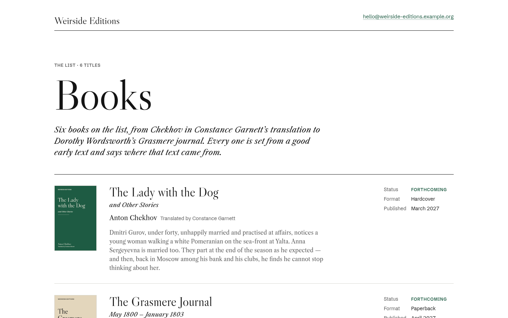

**[Full version US$39](https://themes.formchime.com/themes/backlist/)**



# Astro Backlist Lite

A free, MIT-licensed Astro theme for a small press or a self-publishing author: one list of books and a page for each book, set like a publisher's seasonal catalogue — white paper, Libre Caslon and Schibsted Grotesk, a single cloth-green accent, and **typographic covers generated from each book's title and author**, so you never need a placeholder image. Static, no JavaScript, Lighthouse 95+.

> **Demo content.** *Weirside Editions* is a fictional press. Its six books are real public-domain works by real, long-dead authors and translators; the excerpts are quoted from Project Gutenberg transcriptions (Chekhov #13415, Mansfield #1429, Tagore #7166, Dorothy Wordsworth #42856, Hamsun #8387, Jewett #367). The editions, ISBNs (checksum-valid, marked “Demo”), prices and bookshop links (example.com) are invented. Replace them before you publish.
>
> **About the demo ISBNs.** They use the prefix 978-1-917650, which is a block that may be registered to a real publisher or print-on-demand service. None of these numbers is assigned to Weirside Editions or to any real book (no Open Library match), and the site marks each one “Demo”. Never print them on a real book or reuse them. Replace every ISBN with numbers from your own registrant before you publish.

## Install
```bash
nvm use        # Node 22
npm install
npm run dev    # http://localhost:4321
npm run build  # ./dist
```

## Add your books
1. `src/press.config.ts` — press name, tagline, intro, email; set `demo: false`.
2. One Markdown file per book in `src/content/books/`: `title`, `subtitle`, `author`, `credit` (e.g. “Translated by …”), `status` (forthcoming | new | in-print | out-of-print), `format`, `isbn` (the build rejects a wrong ISBN-13 check digit), `pubDate`, `pages`, `trim` (`129x198` mm — the cover is drawn at this proportion), `price`, `currency`, `buyUrl`, `coverColour` (`green`, `slate`, `brick`, `ochre`, `sand`, `rose` or `#hex`), `coverBreaks` (`"The Lady|with the Dog"`), optional `cover` image and `excerpt`. The body is the description.
3. Set `site` in `astro.config.mjs`.

Each book page carries schema.org `Book` markup (ISBN, format, date, offer). That is correct markup, not a promise of a Google rich result.

## Lite and the full theme
| | Lite (this repo, MIT) | Backlist (paid) |
|---|---|---|
| List | One list page | Table and cover views, filters for series, subject, format, status, language (URL state) |
| Editions | One edition and ISBN per book | Work → editions (hardcover, paperback, ebook, audiobook), each with its ISBN, date, prices, links; duplicate-ISBN checks |
| People | Author as text | Authors, translators, illustrators, editors with their own pages, grouped by role |
| Status | Set by hand | Computed at build from dates |
| Series | — | Series pages, numbers, colours |
| Covers | One layout | Three series layouts, real trim per edition, `/covers/<isbn>.svg` |
| Catalogue | — | Printable A4 seasonal catalogues + `catalogue.csv` |
| Trade, rights, submissions | — | Full pages; submissions window opens and closes itself |
| Structured data | `Book` | `Book` + `workExample` per edition, `BookSeries`, `Person`, `Event`; RSS; events with `.ics` |

The full theme: https://themes.formchime.com/

## Deploy
`npm run build` → `dist` (Node 22). Cloudflare Pages (preset Astro, `NODE_VERSION=22`), Netlify, Vercel, GitHub Pages or any static host.

## License
MIT — see `LICENSE`. Theme by Formchime / Smallbench Labs. Fonts under the SIL Open Font License.
